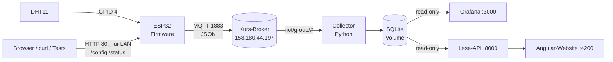

# IIoT-Temperaturüberwachung für yourmuesli.at

Gruppenabgabe zu Teil 1 (Termine 1–3) der Lehrveranstaltung *Industrial Internet of Things*
(MECH-M-DUAL-3-IOT, MCI, WS 2026). Ein ESP32 mit DHT11 misst Temperatur und Luftfeuchte,
sendet die Werte per MQTT an den Kurs-Broker und ist im lokalen Netz über eine HTTP-API
konfigurierbar. Ein Docker-Stack speichert die Nachrichten **aller** Gruppen in SQLite und
zeigt sie in Grafana und einer eigenen Angular-Website an.

Ausführliche Dokumentation (Anleitungen, IT-Hinweise, Developer-Teil):
[docs/Dokumentation.qmd](docs/Dokumentation.qmd) · Details zum Container-Stack:
[infrastructure/README.md](infrastructure/README.md). Die Dokumentation ist auch auf der Website
(Tab **Dokumentation**, <http://localhost:4200/doku>) abrufbar.

## Gruppe

| | |
|---|---|
| Mitglieder | Oskar Klöpfer, Carl Hirschberg, Can Kal, Daniel Brose |
| MQTT-Gruppenname | `kloepfer-brose-hirschberg-kal` |
| Topics | `iiot/group/kloepfer-brose-hirschberg-kal/sensor/{temperature,humidity}/state`, `iiot/group/kloepfer-brose-hirschberg-kal/status` |

## Video

Bildschirmaufnahme (3–5 min): **TODO Link einfügen**

## Erreichter Stand

| Bereich | Beanspruchte Stufe | Umsetzung |
|---|---|---|
| Termin 1 – MQTT | Spezifikation erfüllt | JSON nach [`conventions.md`](docs/iot-specs/conventions.md)/[`asyncapi.yaml`](docs/iot-specs/asyncapi.yaml): `timestamp` (UTC via NTP), `value`, `unit`, `sensor_id`; Status `ok`/`error` retained, Last Will `{"status":"offline"}` |
| Termin 2 – HTTP-API | Tests **sehr gut** (Schemathesis) | `GET/POST /config`, `GET /status` nach [`openapi.yaml`](docs/iot-specs/openapi.yaml) 1.2.0; Tests mit pytest **und** Schemathesis, zusätzlich REST-Client-Datei |
| Termin 3 – Cloud | **sehr gut + Bonus** | SQLite-Datenbank, automatische Aufnahme aller Gruppen über `iiot/group/#`, Geräteübersicht aus `iiot/group/+/status` (Anzahl, letzte Verbindung, Status), Kennzahlen Min/Max/Mittelwert |

Am 26.11.2026 auf echter Hardware geprüft: Flashen, serielle Ausgabe, spec-konforme Nachrichten am
Kurs-Broker, `POST /config` ändert das Sendeintervall sichtbar, Last Will `offline` nach dem Trennen,
alle 35 HTTP-API-Tests grün, Daten und Geräteübersicht im laufenden Stack.

Was nicht bzw. eingeschränkt funktioniert:

- WLAN-Zugangsdaten werden beim Kompilieren aus `.env` übernommen; ein Wechsel des WLANs erfordert
  neues Flashen (kein Captive-Portal).
- Keine Verschlüsselung/Authentifizierung der HTTP-API; MQTT zum Kurs-Broker unverschlüsselt (Vorgabe).
- Die Arduino-Bibliothek `WebServer` schließt bei der HTTP-Methode `QUERY` und bei
  `multipart/form-data` ohne Boundary die Verbindung ohne Antwort (statt 405/400). Das Gerät läuft
  weiter; der pytest-Lauf prüft genau das, die Schemathesis-Kommandozeile meldet diese zwei Fälle als Fehler.
- Der Stack sammelt nur, solange er läuft; Lücken während der Laufzeit werden nicht nachgeladen.
- Website und Grafana sind nur auf dem eigenen Rechner (`127.0.0.1`) erreichbar, nicht vom Smartphone.

## Überblick



Der ESP32 misst im eingestellten Intervall (Standard 5 s) und publiziert pro Messgröße eine
Nachricht. Der **Collector** abonniert alle Gruppen, archiviert jede Rohnachricht, extrahiert
Messwerte (`readings`) und pflegt eine Gerätetabelle (`devices`) mit Status und letzter Verbindung.
**Grafana** und die **Lese-API** greifen nur lesend auf die Datenbank zu; die **Website** zeigt die
Messdaten und bietet zusätzlich eine Oberfläche für die HTTP-API des ESP32.

```text
src/esp32_firmware/      Firmware (PlatformIO/Arduino) – unsere Lösung
src/raspi_firmware/      Vorlage für den Pico W (nicht verwendet)
tests/                   HTTP-API-Tests (pytest, Schemathesis, device.http)
compose.yaml             Docker-Compose-Datei des Stacks
infrastructure/          Collector, Lese-API, Grafana-Provisioning, Integrationstest
Website/                 Angular-Website (Geräte-API, Messdaten, Sensorübersicht, Doku)
docs/                    Quarto-Doku, Spezifikationen in docs/iot-specs/
```

## Mikrocontroller einrichten

**Hardware:** ESP32-DevKit (esp32dev), DHT11, 3 Jumper-Kabel, USB-Kabel (Daten, nicht nur Laden).

| DHT11 | ESP32 |
|---|---|
| VCC / `+` | 3V3 |
| DATA / `out` | GPIO 4 |
| GND / `-` | GND |

Bei einem DHT11 ohne Platine zusätzlich 10 kΩ zwischen DATA und VCC.

**Firmware aufspielen** (einmalig [VS Code](https://code.visualstudio.com/) mit Erweiterung
*PlatformIO IDE* oder `pip install platformio` installieren):

```bash
git clone https://github.com/clHirschberg/MECH-M-3-IIoT.git
cd MECH-M-3-IIoT/src/esp32_firmware
cp .env.example .env        # entspricht der settings.toml der Pico-Vorlage
```

In `src/esp32_firmware/.env` das **bestehende 2,4-GHz-WLAN** und das Broker-Passwort eintragen:

```dotenv
WIFI_SSID="Firmen-WLAN"
WIFI_PASSWORD="geheim"
MQTT_HOST="158.180.44.197"
MQTT_USER="bobm"
MQTT_PASSWORD="<in der Vorlesung erfragt>"
```

ESP32 per USB anschließen, dann:

```bash
pio run -t upload           # kompilieren und flashen
pio device monitor          # serielle Konsole, 115200 Baud
```

**Prüfen:** Die Konsole zeigt `WiFi connected. IP: 192.168.x.y`, `Time synced: …`,
`connected!` und anschließend im Intervall `Published iiot/group/kloepfer-brose-hirschberg-kal/sensor/…`.
Am Broker (z.B. MQTT Explorer oder `mosquitto_sub`) erscheinen die Nachrichten:

```bash
mosquitto_sub -h 158.180.44.197 -u bobm -P '<passwort>' -t 'iiot/group/kloepfer-brose-hirschberg-kal/#' -v
```

```json
{"timestamp":"2026-11-27T10:15:00Z","sensor_id":"iot-gruppe-5","value":21.4,"unit":"°C"}
```

Wird das Gerät getrennt, setzt der Broker nach Ablauf des Keep-Alive (ca. 20 s) den Status auf
`{"status":"offline",…}`. Häufige Fehler: Punkte ohne Ende nach „Connecting to WiFi“ → SSID/Passwort
oder 5-GHz-Netz; `failed, rc=5` → falsches MQTT-Passwort; Status `error` → Sensor-Verkabelung.

## Container starten

Voraussetzungen: Git und Docker (Docker Desktop oder Docker Engine) mit Compose ≥ 2.24.4.
Node.js und Python sind für den Betrieb nicht nötig. Die Compose-Datei liegt im Hauptverzeichnis:
[`compose.yaml`](compose.yaml) (von `docker compose` automatisch gefunden).

```bash
git clone https://github.com/clHirschberg/MECH-M-3-IIoT.git
cd MECH-M-3-IIoT
cp .env.example .env
```

In `.env` mindestens `MQTT_PASSWORD` (Kurs-Broker) und ein selbst gewähltes
`GRAFANA_ADMIN_PASSWORD` eintragen. Danach:

```bash
docker compose up -d --build
docker compose ps                         # collector, api, grafana, website: healthy
docker compose logs --tail=50 collector   # erwartet: "MQTT connected; subscribed to ..."
```

Stoppen mit `docker compose stop`, wieder starten mit `docker compose start`.
`docker compose down` entfernt die Container, die Daten bleiben im Volume
(**`down -v` löscht alle Messdaten**). Backup/Restore: [infrastructure/README.md](infrastructure/README.md#backup-und-wiederherstellung).

## Dashboard nutzen

| Ansicht | URL | Login |
|---|---|---|
| Grafana-Dashboard | http://localhost:3000 → Dashboards → IIoT → *IIoT Übersicht* | `admin` / `GRAFANA_ADMIN_PASSWORD` aus `.env` |
| Angular-Website | http://localhost:4200 | – |
| Lese-API (Swagger) | http://localhost:8000/docs | – |

Grafana (Aktualisierung alle 10 s, Gruppenfilter oben):

- **Anzahl Sensoren** – bekannte, aktive (Messwert < 5 min), Status `ok` und gestörte Geräte.
- **Geräteübersicht** – je Gruppe Status (`ok` grün, `error`/`offline` rot, `unknown` orange),
  Zeitpunkt der letzten Statusmeldung, letzte Verbindung, letzter Wert.
- **Temperatur / Luftfeuchtigkeit** – Zeitreihen aller gewählten Gruppen und Sensoren.
- **Alle Messwerte im Zeitraum** – Kennzahlen Anzahl, Minimum, Maximum, Mittelwert.
- **Letzte empfangene Nachrichten / Letzte Messwerte** – Rohnachrichten inkl. Parserfehler.

Website: Tab **Messdaten** mit Sensorübersicht und Diagrammen (Filter für Zeitraum, Gruppe, Sensor,
Min-/Max-Band, Aktualisierung 5/10/30 s) und Tabelle **Kennzahlen im Zeitraum** (Anzahl, Minimum, Maximum,
gewichteter Mittelwert pro Sensor und Messgröße; folgt dem Zoom im Diagramm); Tab **Geräte-API** zum Lesen von Status/Konfiguration und
Ändern des Sendeintervalls (IP-Adresse des ESP32 eingeben, Rechner muss im selben Netz sein)); Tab
**Dokumentation** mit dieser Projektdoku. Oben rechts lässt sich zwischen Hell, Dunkel und System umschalten.

**Datenbank ansehen** (Stufe *befriedigend*):

```bash
docker compose exec collector python -c "import sqlite3; d=sqlite3.connect('/data/measurements.sqlite'); [print(r) for r in d.execute('SELECT group_name, status, last_seen, last_value, unit FROM devices')]"
```

**Neuer Sensor ohne Konfiguration** (Stufe *gut*): erscheint nach einer Testnachricht automatisch:

```bash
mosquitto_pub -h 158.180.44.197 -u bobm -P '<passwort>' \
  -t 'iiot/group/test-<name>/sensor/temperature/state' \
  -m '{"timestamp":"2026-11-27T10:00:00Z","value":22.5,"unit":"°C","sensor_id":"test"}'
```

## HTTP-API

Spezifikation: [docs/iot-specs/openapi.yaml](docs/iot-specs/openapi.yaml). Die IP steht in der
seriellen Konsole bzw. im Router.

```bash
curl http://<esp-ip>/status
curl http://<esp-ip>/config
curl -X POST http://<esp-ip>/config -H 'Content-Type: application/json' \
     -d '{"reading_interval_seconds": 10}'
```

| Endpunkt | Antwort |
|---|---|
| `GET /config` | `{"device_id":"iot-gruppe-5","reading_interval_seconds":5}` |
| `POST /config` | ändert `reading_interval_seconds` (2–86400 s, dauerhaft im Flash), Antwort wie GET |
| `GET /status` | `device_id`, `uptime_seconds`, `wifi_connected`, `mqtt_connected`, `last_telemetry`, `last_humidity_percent`, zusätzlich `status`, `wifi_rssi`, `ip` |
| Fehler | `400` ungültiges JSON/Wert, `404` unbekannter Pfad, `405` falsche Methode (mit `Allow`-Header) – jeweils `{"error": "…"}` |

**Testfälle ausführen** (Rechner im selben Netz wie der ESP32, Python 3.12 und
[pdm](https://pdm-project.org/)):

```bash
pdm install -G test
DEVICE_URL=http://<esp-ip> pdm run pytest -v                       # pytest + Schemathesis
pdm run schemathesis run docs/iot-specs/openapi.yaml --url http://<esp-ip>   # alternativ CLI
```

[`tests/test_device_api.py`](tests/test_device_api.py) prüft gezielt GET/POST, Roundtrip, Grenzen,
400/404/405 und ob das neue Intervall tatsächlich verwendet wird;
[`tests/test_openapi_schemathesis.py`](tests/test_openapi_schemathesis.py) erzeugt Anfragen aus der
Spezifikation und validiert die Antworten. Ohne `DEVICE_URL` werden die Tests übersprungen; die
ursprüngliche Konfiguration wird nach dem Lauf wiederhergestellt. Für manuelle Tests:
[`tests/device.http`](tests/device.http) (VS Code *REST Client*).

## Hinweise für die IT-Abteilung

| Richtung | Ziel | Protokoll/Port | Zweck |
|---|---|---|---|
| ausgehend | `158.180.44.197` | TCP 1883 | MQTT zum Broker |
| ausgehend | `pool.ntp.org`, `time.nist.gov` | UDP 123 | Uhrzeit (NTP) |
| ausgehend | DNS-Server des Netzes | UDP/TCP 53 | Auflösung der NTP-Server |
| lokal | DHCP-Server | UDP 67/68 | IP-Adresse |
| eingehend | ESP32 | TCP 80 | HTTP-API, **nur aus dem LAN** |

Benötigt wird ein 2,4-GHz-WLAN mit WPA2-PSK (kein WPA2-Enterprise/Captive-Portal) ohne
Client-Isolation, damit Wartungsrechner im selben Netz die HTTP-API erreichen. Eine
DHCP-Reservierung für die MAC-Adresse des ESP32 erleichtert den Zugriff. Port 80 darf **nicht**
ins Internet freigegeben werden.

**Fernzugriff auf die HTTP-API:** Der ESP32 steht hinter NAT und Firewall und ist aus dem Internet
nicht direkt erreichbar. Port-Forwarding wäre die einfachste, aber gefährlichste Lösung, da die API
weder Authentifizierung noch TLS hat – jeder könnte die Konfiguration ändern. Vertretbar ist ein
Zugang über das Firmen-VPN (bzw. WireGuard/Site-to-Site) zu einem Gerät im Standortnetz. Ohne
eingehende Verbindungen kommt man aus, wenn die Konfiguration künftig über MQTT erfolgt
(Gerät abonniert z.B. `…/config/set`), da die ausgehende Verbindung ohnehin besteht. Details in
[docs/Dokumentation.qmd](docs/Dokumentation.qmd#empfehlungen-für-die-it-abteilung).

## Sicherheit

Für eine Produktivversion fehlen: TLS für MQTT (Port 8883, in der Firmware vorbereitet) mit
eigenen Zugangsdaten und ACLs pro Gerät statt eines gemeinsamen Broker-Kontos;
Authentifizierung (Token) und HTTPS bzw. Abschaltung der HTTP-API zugunsten einer Konfiguration
über MQTT; WLAN-Einrichtung ohne neues Flashen und signierte OTA-Updates; ein betriebener Server
mit HTTPS, Benutzerverwaltung und Reverse Proxy statt `localhost`, damit das Dashboard auch mobil
erreichbar ist; automatische Backups und eine Aufbewahrungsfrist der Daten. Geheimnisse liegen
nur in `.env`-Dateien, die per `.gitignore` ausgeschlossen sind.
